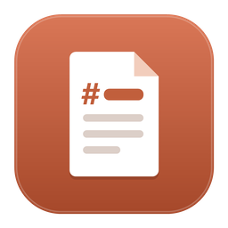
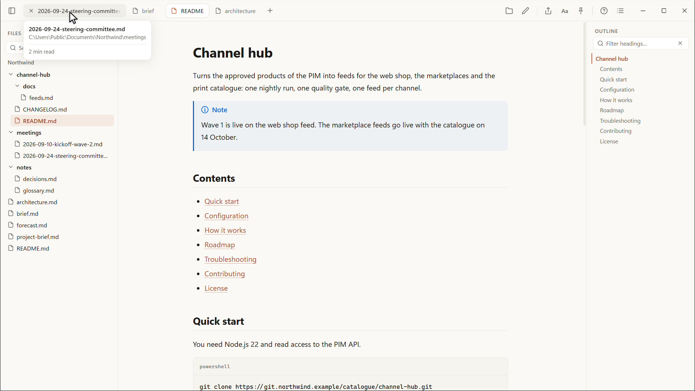
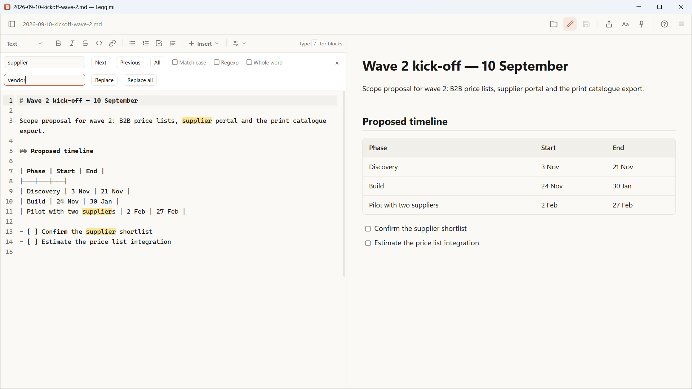
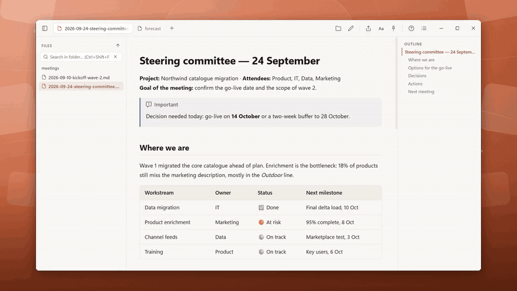

<p align="center">
  
</p>

# Leggimi

<p align="center">
  <a href="https://apps.microsoft.com/detail/9PG51TBZ2CB1?cid=github-badge&mode=direct"></a>
  <a href="https://github.com/enricodestefanis/leggimi/releases/latest"></a>
  <a href="LICENSE"></a>
  
  <a href="PRIVACY.md"></a>
</p>

*Leggimi* — Italian for "read me" — is a fast Markdown viewer and editor for Windows, built with
Tauri 2. Double-click a `.md` file and it opens in a clean, centered reading column, where you
left it, with light, sepia, dark and black themes; an optional edit mode adds a split view with a
live preview. Files are only modified when you save explicitly. The interface speaks English,
Italian, German, French, Spanish and Simplified Chinese.

<p align="center">
  
  
</p>

<p align="center">
  
</p>

## Install

<p align="center">
  <a href="https://apps.microsoft.com/detail/9PG51TBZ2CB1?referrer=appbadge&cid=github-button&mode=direct">
    
  </a>
</p>

- **Microsoft Store** (recommended): install from the [Store page](https://apps.microsoft.com/detail/9PG51TBZ2CB1?cid=github-readme&mode=direct);
  updates arrive automatically.
- **winget**: the same Store package from the command line:

  ```powershell
  winget install --id 9PG51TBZ2CB1 --source msstore
  ```
- **Direct download**: the NSIS installer (`Leggimi_x.y.z_x64-setup.exe`) is attached to every
  [GitHub release](https://github.com/enricodestefanis/leggimi/releases/latest). It is not
  code-signed, so SmartScreen may ask you to confirm on first run.
- **Portable**: `Leggimi_x.y.z_x64-portable.zip` on the same releases page; see below.

All three are the same app, free, with no accounts, no ads and no telemetry.

### Portable build

The portable zip is for a USB stick, a projects folder, or a work PC where you cannot install
anything. It is published only on GitHub Releases (the Store distributes the MSIX package).

- **Use it**: unzip anywhere you can write to and run `Leggimi.exe`. Nothing is installed: no
  file association, no Start menu entry, no `leggimi` command. Open files with `Ctrl+O`, by
  dropping them on the window, from the file browser, or from a terminal by path:
  `Leggimi.exe path\to\file.md --line 40`.
- **Where things live**: the `leggimi-portable.txt` marker next to the exe makes the app keep
  its settings, recent files, reading positions and recovery drafts in a `data` folder beside
  it, instead of the user profile. Move or copy the whole folder and everything travels with it.
  Delete the marker to use the per-user location like the installed app.
- **Side by side**: the portable copy has its own instance identity, so it runs next to an
  installed Leggimi without stealing its files or settings.
- **Update**: unzip the new version over the old folder (or replace `Leggimi.exe`); `data` is
  kept. There is no automatic update.
- **SmartScreen**: like the installer, the exe is not code-signed; on the first run Windows may
  ask you to confirm (More info → Run anyway).

## Features

- Documents always open in **viewer mode**; `Ctrl+E` switches to **edit mode**: CodeMirror
  editor on the left, live preview on the right, updated as you type; a double-click on the
  preview puts the editor's cursor on that word
- Explicit save with `Ctrl+S` (the unsaved-changes dot turns into a check for a moment) and
  confirmation guards; line endings (CRLF/LF) are preserved on save
- If a preview render fails mid-edit, the last good preview stays on screen and a dismissable
  notice appears — the pane never goes blank
- **Formatting help in edit mode**: a format bar (headings, bold, italic, strikethrough, code,
  links, lists, task lists, quotes), the usual shortcuts, and a **`/` menu** at the start of a
  line that inserts tables, Mermaid diagrams, KaTeX formulas, code blocks and callouts. The file
  stays plain Markdown — every command just edits the text
- **Find & replace** (`Ctrl+F` / `Ctrl+H`), **spellcheck** with the dictionary of the interface language, line
  commands (`Alt+↑` / `Alt+↓` move, `Shift+Alt+↓` duplicate, `Ctrl+Shift+K` delete, `Alt+L`
  select), **Comment line** (`Ctrl+/`) to hide lines from the reader, more cursors (`Ctrl+D`
  for the next occurrence, `Ctrl+Alt+↑` / `↓`), **go to line** (`Ctrl+Alt+G`), and a
  **recovery draft** that offers your unsaved text back after a crash
- **Paste or drop images in edit mode**: they are saved to an `assets/` folder next to the
  document and linked with a relative path, Typora-style
- GitHub-flavored Markdown: tables, task lists, strikethrough, autolinks (`www.` addresses
  too), **footnotes**, and **heading anchors as on GitHub**, so tables of contents written for
  GitHub or by AI assistants work; task-list checkboxes are **live** (a click on the box
  updates the file, with Undo; clicking the text only selects it), and `Ctrl+C` copies a
  selection with its formatting
- **Wide tables and diagrams** get the room they need: past the reading column, up to the
  width of the window, instead of scrolling sideways or shrinking; when printing, a table wider
  than the page is scaled to fit. Every table has **Copy table (for Excel)** and **Open
  preview** buttons
- **YAML front matter** folded into a block at the top of the document: click it to see the
  fields as a table, instead of reading them as stray text
- Syntax-highlighted code blocks with a copy button
- **Mermaid** diagrams, bundled locally so they work offline
- **Full-window preview** for diagrams, images and tables: click a diagram or an image (a table
  from its button) to open it, zoom with `+` / `−` or the scroll wheel around the pointer, drag
  to pan, `0` to fit, `W` to fit the width, `1` for 100%, `Esc` to close — and a menu to copy
  it as PNG (2× or 4×) or SVG, or save it to a file. Diagrams fill the window and stay sharp
  at any zoom
- **KaTeX math**: `$…$` inline, `$$…$$` or ` ```math ` fences for display blocks
- **GitHub-style callouts**: `> [!NOTE]`, `[!TIP]`, `[!IMPORTANT]`, `[!WARNING]`, `[!CAUTION]`
- Clickable **outline** with scroll-spy, and a **filter box** on long documents (type, then
  `↑` / `↓` and `Enter` to jump); after a jump, the heading you land on lights up briefly
- **Picks up where you left off**: every document remembers its reading position, and the
  empty screen lists your **recent files**
- **Reading keys**: `j` / `k` scroll, `.` / `,` jump between headings, `g g` / `G` go to the
  top and the end, `n` / `N` step through find matches, `?` shows the quick reference. A
  hairline along the top of the document shows the progress and the toolbar the estimated
  reading time; the document can also be dragged like a sheet of paper (middle button)
- **Smart links**: `[text](other)` finds `other.md`, `[text](folder/)` opens the folder's
  `index.md` or `README.md` (or shows the folder in the file browser), `other.md#section` jumps to
  the heading; a link to an image opens the preview, to any other file (a PDF, a spreadsheet) a
  notice offers to open it in its own app, and `mailto:` links open the mail app
- **Right-click menu of the document** (also `Shift+F10` or the menu key): copy the selection
  (with its formatting or as plain text) or search for it in the document or the folder; open,
  copy or open in a new window a link; open an image, a diagram or a table in the preview; copy
  a code block or a table; **Copy link to this section** (`[Heading](file.md#heading)`,
  followed by Leggimi from any other document, and by GitHub); **Edit from here**; **Copy the
  whole document**; print or save as PDF
- Right-click a file for **Open in a new window**, **Show in File Explorer**, **Copy path** and
  **Copy as Markdown link**; a **pin** button (`Ctrl+Shift+T`) keeps the window on top
- **More than one document at a time**: a file opened from outside (double-click, *Open with*,
  `leggimi file.md`) gets a window of its own, or brings forward the window that already shows
  it; `Ctrl`+click (or the middle button) opens a file, a recent document or a link in a new
  window, `Ctrl+Shift+N` an empty one; the theme and the text settings follow in every window
- **Back and forward** like a browser (`Alt+←` / `Alt+→`, the mouse's side buttons): after a
  link to a section, a jump through the outline or a move to another document
- **File browser** for the Markdown files in the folder you opened, kept up to date as files
  come and go on disk: a renamed open document is followed, a deleted one stays on screen with
  **Save again**; collapsed folders are remembered across navigation and restarts, and the
  keyboard moves through it as a tree
- **Resizable side panels**: drag the inner edge of the file browser or the outline to widen it
  (double-click to restore the default), and size their text independently of the document with
  **Panels** in the reading settings
- **Fits half a screen**: a window can be as narrow as 480 px (next to Teams, in a Windows 11
  snap layout); the outline and then the file browser fold away and open over the text when
  called, and below about 760 px edit mode shows the editor alone
- **Search across the folder** (`Ctrl+Shift+F`): full-text and file-name matches with
  snippets; opening a result highlights the term in the document
- **Live reload** when the file changes on disk, preserving your reading position; with unsaved
  edits it warns instead of overwriting your buffer, and saving over a file that changed since
  you opened it asks first
- **Share menu** (`Ctrl+Shift+E`) collecting everything that leaves the app: **copy as rich
  text** (`Ctrl+Shift+C`) to paste with formatting into Outlook, Word or Teams; **print**
  (`Ctrl+P`) and **one-click Save as PDF**, both with a header (title, date) and page numbers
  and an optional page break at every heading 1; **export to self-contained HTML or DOCX** —
  in Word, math becomes native equations and Mermaid diagrams become images
- A paragraph that is just `[TOC]` renders as a table of contents of the headings below it
- **Reading settings** (the `Aa` button): text size (`Ctrl+=` / `Ctrl+−` / `Ctrl+0` /
  `Ctrl`+scroll), sans or serif font, line spacing, column width and the **light / sepia /
  dark / black / follow Windows** theme — all remembered across restarts, never affecting
  print or export;
  the editor text scales along with the size, and **Panels** sizes the side panels
- **Accessible**: WCAG AA contrast in all four themes, visible keyboard focus, menus that work
  with the arrow keys, a file browser that screen readers read as a tree, notices read aloud,
  and scrolling that follows Windows' *Animation effects* setting
- Find in document (`Ctrl+F`), relative images, video and audio (`srcset` and `<picture>` too);
  README logos made for GitHub's light and dark themes (`#gh-dark-mode-only`, `<picture>`
  sources) follow Leggimi's theme
- Simple HTML works (`<br>`, `<kbd>`, `<details>`…); as on GitHub, tags that would change the
  page (`<style>`, `<script>`, `<title>`, `<iframe>`…) show as text, and a tag that is not HTML
  stays hidden
- Opened files land in Windows' **Recent items and the taskbar jump list**
- Double-click any `.md` file in File Explorer — the installer registers the association — and
  create one with File Explorer's **New → Markdown document**
- Drag and drop files onto the window, or press `Ctrl+O`; several at once open one per window
- `F5` or `Ctrl+R` reads the open file again from disk, keeping your place
- Built-in help (`F1`) showing the running version
- **Six languages**: English, Italian, German, French, Spanish and Simplified Chinese — the
  interface and the help follow the first supported language in your Windows preferred
  languages, with an override in the reading settings
- **Command line**: `leggimi file.md --line 40` opens a file at a line, in the running app
  if there is one; the installer adds the `leggimi` command for terminals

## Keyboard shortcuts

| Keys | Action |
|---|---|
| `Ctrl+O` | Open a file |
| `Ctrl+Shift+N` | New window |
| `Ctrl+W` / `Ctrl+F4` | Close the window |
| `Ctrl`+click / middle click | Open a file, a recent document or a link in a new window |
| `Alt+←` / `Alt+→` | Back / forward (also the mouse's side buttons) |
| `F5` / `Ctrl+R` | Reload the file from disk |
| `Shift+F10` / menu key | Right-click menu |
| `Ctrl+E` | Toggle edit mode |
| `Ctrl+S` | Save the file (edit mode) |
| `Ctrl+F` | Find in document |
| `Ctrl+Shift+F` | Search across the folder |
| `Enter` / `Shift+Enter` | Next / previous match |
| `Ctrl+B` | Toggle the file browser (bold while editing) |
| `Ctrl+I` | Toggle the outline (italic while editing) |
| `Ctrl+Shift+X` / `Ctrl+Shift+M` | Strikethrough / inline code (editing) |
| `Ctrl+K` | Insert a link (editing) |
| `Ctrl+1` … `Ctrl+3` | Heading 1 to 3 (editing) |
| `Ctrl+F` / `Ctrl+H` | Find / find and replace (editing) |
| `Alt+↑` / `Alt+↓` | Move the line (editing) |
| `Shift+Alt+↓` / `Ctrl+Shift+K` | Duplicate / delete the line (editing) |
| `Ctrl+/` | Comment / uncomment the line (editing; `Ctrl+Shift+7` on Italian and German keyboards) |
| `Ctrl+D` / `Alt+L` | Add the next occurrence to the selection / select the line (editing) |
| `Ctrl+Alt+↑` / `Ctrl+Alt+↓` | Add a cursor above / below (editing) |
| `Ctrl+Alt+G` | Go to line (editing) |
| `Esc`, then `Tab` | Leave the editor with the keyboard (editing) |
| `Ctrl+Shift+T` | Keep the window on top |
| `/` | Block menu at the start of a line (editing) |
| `Ctrl+P` | Print or save as PDF |
| `Ctrl+Shift+C` | Copy the document as rich text |
| `Ctrl+Shift+E` | Open the Share menu |
| `Ctrl+=` / `Ctrl+−` | Larger / smaller text |
| `Ctrl+0` | Reset the text size |
| `j` / `k` | Scroll down / up (reading) |
| `.` / `,` | Next / previous heading (reading) |
| `g g` / `G` | Top / end of the document (reading) |
| `n` / `N` | Next / previous find match (reading) |
| `0` / `W` / `1` | Fit / fit the width / 100% (full-window preview) |
| `?` | Quick reference of the keys |
| `F1` | Show help |
| `Esc` | Close the preview, the find bar or help |

## Command line

```
leggimi [file] [--line N]
```

`leggimi README.md` opens the file (relative to the current folder) in a new window of the
running app, or brings forward the window that already shows it, or starts the app. `--line 40` (or `-l 40`) shows that source line at the top: in reading mode the
block containing it, which lights up briefly, in edit mode the editor caret. A file that does
not exist gets a "Not found" notice in the window in front instead of an empty window. The
installer puts a `leggimi` command in
`%LOCALAPPDATA%\Microsoft\WindowsApps`, which is on every user's PATH; the Store build registers
`leggimi.exe` as an app execution alias; the portable build is run by its own path.

## File browser

The left panel is rooted at the folder of the document you opened and lists Markdown files up to
four levels of subfolders (capped at 2000 files). Opening a file from the panel keeps the same
root, so navigating into a subfolder does not hide the rest of the tree; the up arrow moves the
root to the parent folder. Opening a document outside the current root re-roots the panel there.
Folders you collapse stay collapsed while you navigate and across restarts; the folders on the
path of a newly selected file auto-expand to reveal it. Folders with no Markdown files are
hidden, as are hidden folders and build directories such as `node_modules`, `target` and `dist`.

The panel follows the disk: files added, renamed or deleted in the folder (in File Explorer, by
another program) show up at once. A document renamed while open is followed, unsaved edits
included; one deleted or moved away stays on screen, with a notice offering **Save again**.
From the keyboard the panel is a tree: `↑` / `↓` move, `→` opens a folder or enters it, `←`
closes it or goes up, `Home` / `End` reach the ends, `Enter` or `Space` opens, `Ctrl+Enter`
opens in a new window. In a narrow window it folds away; its toolbar button (or `Ctrl+B`) then
opens it over the text.

## Versioning and releases

`package.json` is the single source of truth for the app version: `tauri.conf.json` reads it
from there, so the window, the installer and the version shown in the app can never drift apart.
The running version appears in the help dialog (`F1`) and on the empty screen.

To cut a release:

```powershell
npm version patch      # a fix        (1.0.0 -> 1.0.1)
npm version minor      # new features (1.0.0 -> 1.1.0)
npm run tauri build    # installer carries the new version
```

Record what changed in [CHANGELOG.md](CHANGELOG.md). `npm version` also creates a git tag; push
it with `git push --follow-tags`. Keep `src-tauri/Cargo.toml` in step for tidiness — it is the
crate version and does not drive what the app displays.

A GitHub release carries two assets from the same build: the installer
`src-tauri\target\release\bundle\nsis\Leggimi_x.y.z_x64-setup.exe` and the portable zip
produced by `npm run package:portable` (`src-tauri\target\release\bundle\portable\`), which
wraps the release exe with the `leggimi-portable.txt` marker and a short `README.txt`. The
Store gets the MSIX below.

### Microsoft Store package

The Store build is an MSIX produced by Microsoft's [winapp CLI](https://learn.microsoft.com/windows/apps/dev-tools/winapp-cli/)
(`winget install Microsoft.WinAppCli`) from the same release exe:

```powershell
npm run package:msix                     # build + package, unsigned (the Store signs it)
npm run package:msix -- -SkipBuild -Sign # reuse the exe, sign with a dev certificate for a local install
```

The package lands in `src-tauri\target\msix\`. The manifest is `src-tauri\msix\Package.appxmanifest`;
its identity values come from Partner Center and its version is stamped from `package.json` at
packaging time. To install a dev-signed package locally, trust the generated certificate once from an
elevated prompt with `winapp cert install src-tauri\msix\devcert.pfx`, then double-click the `.msix`.

The icons in `src-tauri\msix\Assets\` are generated from `src-tauri\icons\icon.png` and committed.
Re-run `npm run gen:icons` after changing the app icon. The `targetsize-*_altform-unplated` variants
are the ones Windows uses for the taskbar, Start and Alt+Tab; without them the shell plates the icon
on the manifest `BackgroundColor`, and on `transparent` that means the system accent colour.

## Development

Requirements: Node 20+, Rust stable, WebView2 (preinstalled on Windows 11).

```powershell
npm install
npm run tauri dev        # development
npm run tauri build      # produces the NSIS installer in src-tauri\target\release\bundle\nsis\
```

Note: in dev mode Vite does not apply the CSP configured in `tauri.conf.json` — test images and
Mermaid in a production build too.

To exercise the UI in a plain browser, run `npm run dev` and open
`http://localhost:1420/dev/harness.html`: it loads the real app with the Tauri backend mocked
and files kept in memory (`?doc=/samples/test-features.md` opens a sample instead of the
generated document).

## Project layout

- `src/` — TypeScript + Vite frontend (markdown-it, highlight.js, DOMPurify, mermaid,
  CodeMirror 6 for the editor)
- `src-tauri/` — Rust backend: file read/write and tree commands, debounced file watcher
  (notify), single instance, `.md` file association
- `samples/` — test documents; `test-features.md` exercises every feature
- `dev/harness.html` — browser test harness for the frontend (not part of the build)

A `private/` folder, if you create one, is excluded from git: use it for personal documents you
want to open in the app without risking committing them.

## License

Leggimi is free and open source software released under the [MIT License](LICENSE).

## Privacy

Leggimi never connects to the internet and collects no data. See [PRIVACY.md](PRIVACY.md).
